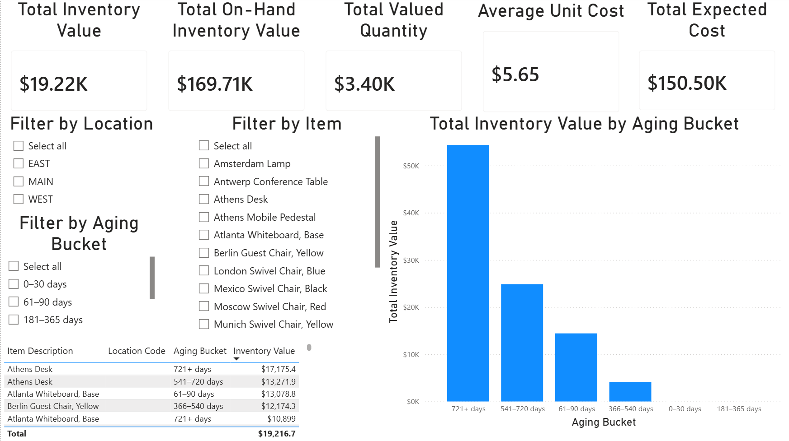
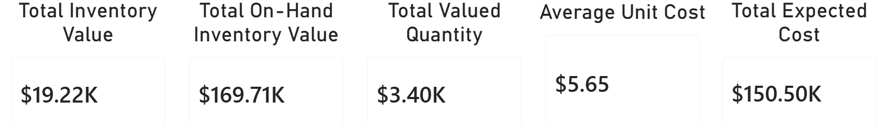
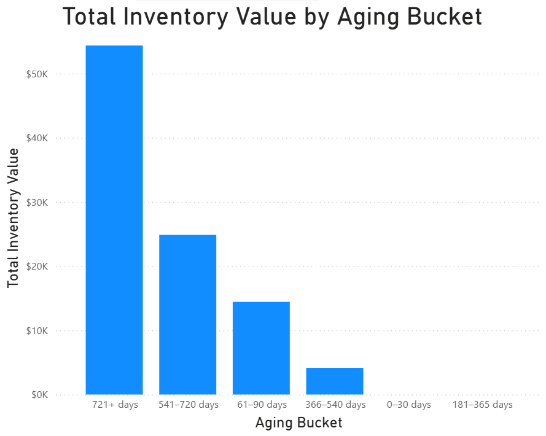
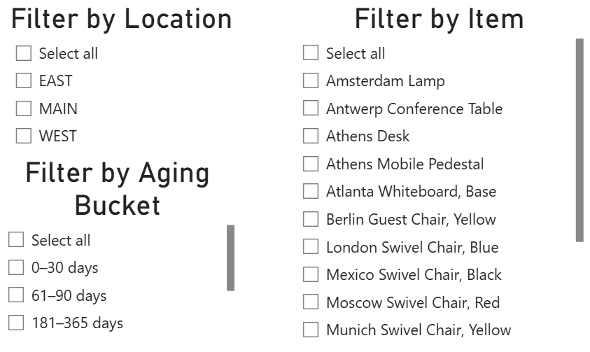
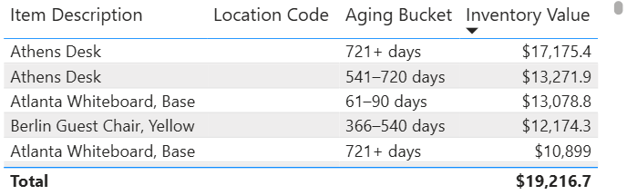
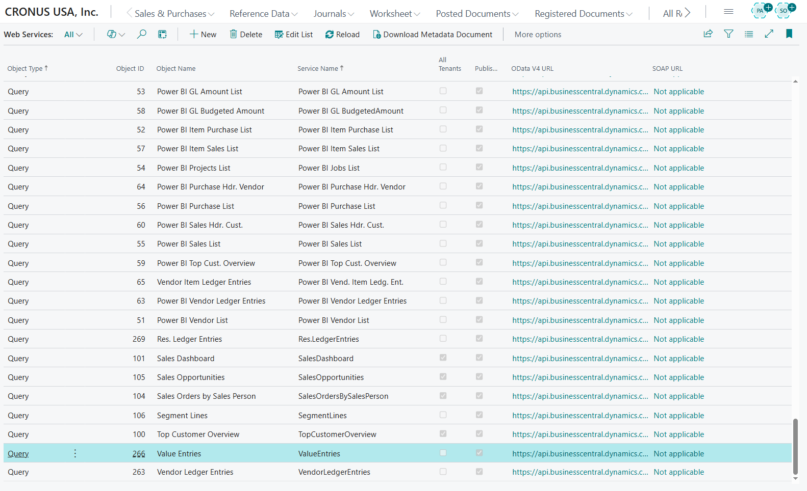

# Business Central Inventory Aging Dashboard

## Description

A Power BI report and data model built on inventory ledger + valuation data from the **CRONUS** demo company in **Microsoft Dynamics 365 Business Central**.

The dashboard features:

- High-level inventory KPIs
- Inventory value by Aging Bucket
- Slicers for Location, Item, and Aging Bucket
- A detail table for drilldown by item and location 
- A report page tooltip that shows **Top N** contributors for the hovered Aging Bucket

All data is loaded from Business Central via **OData Web Services** and modeled in **Power BI Desktop**.

## Objective

Provide an inventory aging overview that shows:

- **How much inventory value exists overall** (summary KPIs)
- **How inventory value is distributed by age** (Aging Bucket chart)
- **Where value is concentrated** (drill with slicers + detail table)
- **What’s driving a selected bucket** (Top N tooltip)

## Technologies

- **Power BI Desktop** – data model, DAX measures, report layout, tooltip page
- **Power Query** – data ingestion and shaping from Business Central OData endpoints
- **Dynamics 365 Business Central (CRONUS demo database)** via **OData Web Services**
- **Git + GitHub** – version control

## Data Sources

Data is pulled directly from Business Central using **OData Web Services**.

Core entities used in the report:

- Inventory transaction/quantity entries (on-hand / movements)
- Valuation/cost entries (actual + expected)
- Item master data
- Location data (when populated)
- Date table (Power BI calculated table)

## Data Model

The model is centered on inventory quantity/value entries with dimensions for slicing and labeling.

- **Facts**
  - Inventory entries (quantities)
  - Valuation entries (amounts)
- **Dimensions**
  -  `Item`
  -  `Location`
  -  `Date` (calculated table)
  -  Aging Bucket logic (calculated column or measure-driven)



## Measures

All core metrics are defined as DAX measures in a dedicated **Measure** table.

```DAX
Total Inventory Value :=
SUM ( 'Value Entry'[Cost Amount (Actual)] )
    + SUM ( 'Value Entry'[Cost Amount (Expected)] )

Total Inventory Value (Abs) :=
ABS ( [Total Inventory Value] )

Total Expected Cost :=
SUM ( 'Value Entry'[Cost Amount (Expected)] )

Total Valued Quantity :=
SUM ( 'Item Ledger Entry'[Quantity] )

Average Cost per Unit :=
DIVIDE ( [Total Inventory Value (Abs)], [Total Valued Quantity] )

Avg Inventory Age (Weighted) = 
DIVIDE (
    SUMX (
        'Inventory-Aging-Fact',
        'Inventory-Aging-Fact'[Days Aged] * 'Inventory-Aging-Fact'[Cost_Amount_Actual]
    ),
    [Total Inventory Value]
)
```

## Report Pages

### 1. Inventory Aging

High-level KPIs, aging distribution, slicers, and a detail table.

#### KPIs

Cards across the top highlight:

- Total Inventory Value
- Total On-Hand Inventory Value
- Total Valued Quantity
- Average Unit Cost
- Total Expected Cost



#### Inventory Value by Aging Bucket

A column chart showing inventory value by bucket.



#### Slicers

Primary slicers:

- Filter by Location
- Filter by Item
- Filter by Aging Bucket



#### Detail Table

A detail table to review item/location-level rows behind the summary view.

Detail Table Columns:

- Item Description
- Location Code
- Aging Bucket
- Inventory Value




---

### 2. Tooltip – Aging Bucket (Report Page Tooltip)

A dedicated tooltip page used by the Aging Bucket chart.

- Displays **Top N** items by inventory value for the hovered bucket.

## Interactions & Filtering

- Slicers filter all KPIs, the bucket chart, and the detail table.
- The bucket chart cross-filters the detail table.

---

## Usage Guide

### Refreshing the Dashboard with a Different Company or Environment

1. Ensure that the target Business Central environment exposes the Value Entries OData endpoint required by the report. 
2. In Power BI Desktop, open Transform data → Data source settings.
3. Update the Business Central OData base URL and credentials.
4. Verify table/field names used by queries remain consistent.
5. Click **Refresh**.

